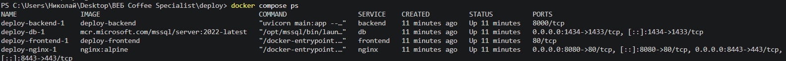
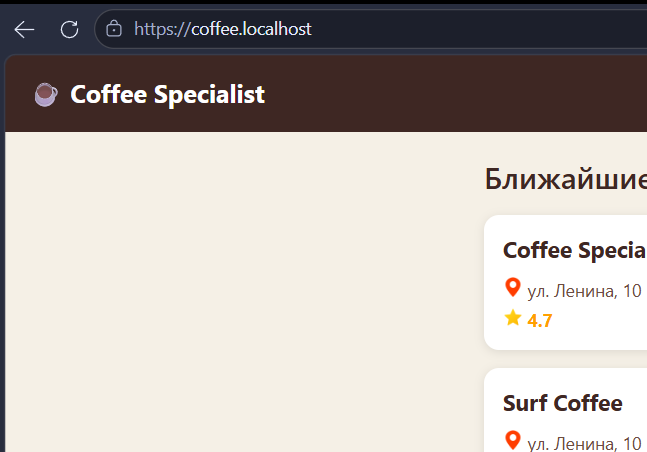
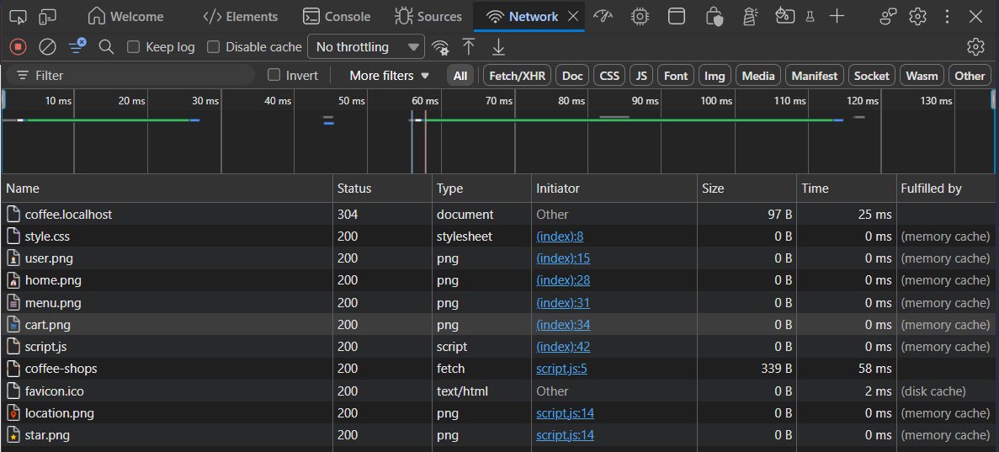
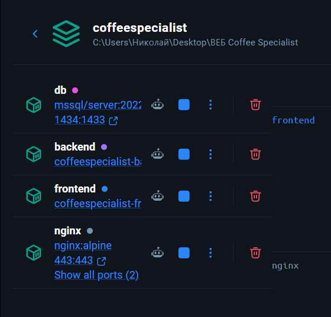

# Деплой проекта Coffee Specialist

## Архитектура
Браузер -> Nginx (HTTPS) -> Frontend (статика) и Backend (FastAPI).
База данных SQL Server изолирована в контейнере.

## Сервисы
| Сервис | Порт | Описание |
| :--- | :--- | :--- |
| nginx | 80, 443 | Обратный прокси, HTTPS |
| frontend | 80 | Статические файлы |
| backend | 8000 | API (Uvicorn) |
| db | 1433 | SQL Server |

## Команды
- Запуск: `docker compose up -d --build`
- Остановка: `docker compose down`

## Скриншоты

### 1. Статус контейнеров (docker compose ps)

### 2. Сайт с HTTPS (https://coffee.localhost)

### 3. Запрос к API (Network)

### 4. Docker Desktop
